# تعدد الوظائف والمسؤوليات التشغيلية وفريق ضبط الجودة — الفحص والتصميم

> **الإصدار 3 (2026-11-26)** — معتمد مبدئياً من المالك. يثبّت Q9–Q12 (الملخّص الآمن للمتابعات، إخفاء هوية المراجع، سياسة «لا يمكن الوصول»، SLA المراجعة).
> الإصدار 2 أدمج فريق الجودة المستقل وQ1–Q8.
> الحالة: **مرحلة التحضير — لا هجرات.** التنفيذ يبدأ بعد تجهيز staging والتحقق من استقلاله ([staging/README.md](../staging/README.md)) وقرار المالك في سجلّ الهجرات ([MIGRATION_HISTORY_REPAIR.md](MIGRATION_HISTORY_REPAIR.md)).

### ما تغيّر في الإصدار 3

| البند | الإصدار 2 | الإصدار 3 |
|---|---|---|
| ملاحظات المبيعات للفريق (Q9) | السجل يُعرض كما هو | **لا نصّ خام أبداً**: حقول منظّمة بقائمة بيضاء + «ملخّص آمن» يُبنى في الخادم من الحقول المنظّمة، أو يُكتب بطلب صريح ويُعتمد. لا تنقية بالـRegex (§٥-٨) |
| هوية المراجع (Q10) | مخفية افتراضياً، قابلة للتغيير | **مخفية دائماً عن البائع** — لا إعداد يكشفها. ظاهرة للقائد والمدير العام وفي سجلّ التدقيق |
| سياسة «لا يمكن الوصول» (Q11) | مقترحة | **معتمدة وقابلة للتعديل من الإدارة**: 3 محاولات، يومان، قناتان، ≥ 4 ساعات |
| SLA (Q12) | مقترح | **معتمد**: 72 ساعة من الإسناد؛ المؤجّل 7 أيام تقويمية من التحويل؛ أول محاولة خلال مهلة؛ تنبيه قبل الانتهاء؛ تصعيد للقائد |
| «لا يمكن الوصول» في CRM | سبب خسارة | **تحقّق:** هو `outcome_class = 'unreachable'` على أسباب الخسارة (347 من 1611). مرحلة «تعذّر الوصول» المستقلة **ليست خسارة** — خارج Q1 (Q13 مفتوح) |
| سجلّ الهجرات | — | السجلّ ليس مصدر حقيقة؛ تسجيل ذاتي من 227 (§١٣-٣) |
> الفحص من القاعدة الحيّة (`tilal-crm`) ومن `sql/` و`docs/` والواجهة. مكمّل لـ [HR_ENTERPRISE_PLAN.md](HR_ENTERPRISE_PLAN.md) و[TASK_SYSTEM_V2_ARCHITECTURE.md](TASK_SYSTEM_V2_ARCHITECTURE.md) و[CRM_ARCHITECTURE.md](CRM_ARCHITECTURE.md) §21.

### ما تغيّر عن الإصدار 1

| البند | الإصدار 1 | الإصدار 2 |
|---|---|---|
| من يراجع | موظف مكلَّف بمسؤولية «Customer QC» | **فريق مراجعة مستقل** (`review_teams`) بقائد وأعضاء ومراجعين من أي قسم، بلا قسم في الهيكل |
| نطاق المراجعات | جودة العملاء فقط (`customer_quality_reviews`) | **محرّك مراجعات عام** (`quality_reviews` + `review_types`): Customer QC الآن، وSales/Marketing/Operational QC لاحقاً بلا جداول جديدة |
| «لا يمكن الوصول» | مستثناة | **مسار مؤجّل**: محاولات اتصال إلزامية من الإعدادات قبل تسجيل النتيجة |
| اعتماد المراجعة | مشرف المبيعات | **داخل الفريق** (مراجع/قائد غير متضارب). الإدارة تستلم النتيجة وتنفّذ الإجراءات ولا تعدّل التقييم |
| وصول الفريق لبيانات العميل | فرع قراءة في سياسات RLS لـ CRM | **دالة عرض واحدة** تُرجع الحقول المسموحة فقط — لأن صفوف `opportunities` و`crm_lost_sales` تحمل أسعاراً وعمولات (Q5). **لا تُمسّ أي سياسة CRM** |
| تضارب المصالح | البائع ومشرفه | البائع، فريقه، مشرفوه، **وكل من شارك في معالجة الحالة** — لقطة محفوظة مع المراجعة وتُفحص عند كل إسناد واعتماد |
| الحالات التاريخية | زرّ دفعة | **معاينة بعدد متوقّع + منع التكرار + تأكيد برمز** |
| أقسام بلا مدير | شرط للوحات | **ليس شرطاً**: المدير العام مسار تصعيد مؤقت، والإسناد يُحسب وقت الحاجة فيتحدّث تلقائياً عند تعيين مدير |
| ترقيم الهجرات | 227–235 | 227–236 بعد التحقق (§١٣-١) |

---

## ٠) الخلاصة

- **لا نظام HR جديد ولا نظام مهام أو موافقات موازٍ.** نحو ٧٠٪ من المطلوب موجود وحيّ وسيُوسَّع: الأقسام والمناصب والأدوار والمصفوفة (145–146)، الموافقات (153)، البدلات والمكافآت في الكشف (157)، المؤشرات والأهداف والتقييم (160)، المهام V2 بقوالبها ومساراتها وتكرارها وأتمتتها (189–199)، تحليل الخسارة ومراجعة المشرف وإعادة التنشيط (140–178، 221–222)، التدقيق والإشعارات.
- **الجديد ستة أشياء:**
  1. `employee_positions` — تعيينات وظيفية متعددة بتاريخ؛ الأساسية تبقى مرآتها في `employees`.
  2. `responsibility_catalog` + `responsibility_assignments` — المسؤوليات التشغيلية.
  3. صلاحيات من الوظيفة الإضافية (بتفعيل المدير العام) ومن المسؤولية ومن المنح المباشر، تُجمع في `effective_permissions()` بمصدر كل صلاحية وتاريخ منحها وانتهائها.
  4. **فرق المراجعة** `review_teams` + `review_team_members` — مستقلة تشغيلياً، أعضاؤها تابعون إدارياً لأقسامهم.
  5. **محرّك المراجعات** `review_types` + `quality_reviews` — Customer QC أول نوع.
  6. الحمل الوظيفي (مخطّط + فعلي) وتجاوز ١٠٠٪ عبر محرّك الموافقات القائم.
- **لا تُمسّ:** الحالات الأربع للمهام، `profiles.role` (~٤٠٠ سياسة)، أي سياسة RLS في CRM، `crm_lost_sales` (لا تكتب فيه المراجعة أبداً)، الراتب الأساسي.

---

## ١) الفحص

### ١-١) الأرقام الحيّة (2026-11-24/26)

| البند | القيمة |
|---|---|
| موظفون نشطون | 12 |
| مناصب / موظفون بمنصب | 22 / 15 |
| أقسام / لها مدير | 19 / **3** |
| موظفون لهم مدير مباشر | 13 |
| أدوار | 22 (10 نظامية + 12 وظيفية) |
| وحدات المصفوفة المفروضة | organization, recruitment, employees, attendance, leaves, payroll, advances, performance, documents, hr_reports. **غير مفروضة:** tasks, crm, sales, marketing, accounting, commissions, brokerage, projects, inventory, expenses |
| قوالب مهام / مسارات / قواعد أتمتة | 7 / 3 / 4 (**كلها معطّلة**) |
| مؤشرات / بدلات / مراجعات أداء | 19 / **0** / 0 |
| خسائر `crm_lost_sales` | 1611 (مراجعة المشرف: `pending` 1610، `confirmed` 1) — النتيجة: `lost` 1407، `relost` 198، `reactivated` 6 |
| أسباب الخسارة | 86 بفئات؛ `outcome_class` المستعمل: `unreachable` |
| مهام مفتوحة | 8 |
| سير الموافقات | leave, leave_unpaid, attendance, overtime, bonus, leave_encashment, expense, termination |
| امتدادات | `pg_trgm`, `pg_cron`, `pgtap` — **`btree_gist` غير مثبّت** |

### ١-٢) ما هو موجود / يُعدَّل / يُنشأ

| المطلوب | الموجود | القرار |
|---|---|---|
| القسم | `departments` (شجرة) | **REUSE** |
| تعريف الوظيفة | `positions` | **REUSE** |
| تعيين الموظف في وظائف | `employees.position_id/department_id/manager_id` (واحد) | **ADD** `employee_positions`؛ الأعمدة الثلاثة مرآة الأساسية (نمط 216) |
| المسؤولية التشغيلية | لا شيء | **ADD** `responsibility_catalog` + `responsibility_assignments` |
| فريق الجودة | لا شيء (`mkt_team` خاص بالتسويق ولا يُعمَّم) | **ADD** `review_teams` + `review_team_members` |
| المراجعة | `crm_lost_sales.review_status` (مراجعة المشرف لاستمارة البائع) | **يبقى كما هو**. **ADD** `quality_reviews` طبقة مستقلة |
| قوالب ومسارات وأتمتة المهام | `task_templates`, `task_workflows/steps`, `task_automation_rules/runs`, `task_emit_event` | **EXTEND** |
| المساعدون / المشرف / التصعيد | `task_watchers` / لا شيء / لا شيء | **EXTEND** / **ADD** عمودين / **ADD** cron |
| الصلاحيات | `roles` + `role_permissions` + `has_permission` / `permission_scope` | **REUSE** + طبقات 3–4 |
| البدلات | `employee_allowances` (بلا اعتماد ولا مصدر)، `build_payroll` يقرؤها | **EXTEND** |
| المكافأة بمؤشر | `employee_bonuses` بسير `bonus` + `employee_targets.achievement_pct` | **REUSE** |
| الموافقات | `approval_*` + `approval_apply` + `current_approvers` (يُحسب وقت القرار) | **REUSE** + سيرَين |
| الأسباب / إعادة التنشيط | `crm_lost_reasons` / `reactivate_lost_opportunity(...)` | **REUSE** |
| التدقيق / الإشعارات / اللوحات | `audit_log` / `notifications` / `hr_dashboard`, `task_overview`, `task_workload` | **EXTEND** / **REUSE** / **EXTEND** |

### ١-٣) ملاحظات الفحص المؤثّرة

| # | الملاحظة | الأثر على التصميم |
|---|---|---|
| A1 | 16 من 19 قسماً بلا مدير | **ليس شرطاً** (Q8). كل إسناد/تصعيد/موافقة لـ«مدير القسم» يصعد في الشجرة ثم يسقط إلى المدير العام، ويُحسب **وقت الحاجة** لا يُخزَّن |
| A2 | المصفوفة لا تُفرض على `crm` و`tasks` | الفريق لا يُعطى وحدة `crm`؛ يُعطى نطاق حالات محدّد |
| A3 | `opportunities` فيها `expected_value`, `won_value`؛ `crm_lost_sales` فيها `unit_price`, `price_per_m2`, `discount`, `lost_value`, `expected_revenue`, `expected_commission`, `competitor_price`…؛ `clients` فيها `budget_min/max` | RLS تفتح صفوفاً بكل أعمدتها ⇒ **لا فرع RLS للفريق**. القراءة عبر `qr_case_view()` بحقول محدّدة (Q5) |
| A4 | `has_permission` داخل سياسات RLS | التوسيع بمسار سريع ودالة مجمَّعة مرة للاستعلام (درس 198/211) |
| A5 | `employee_allowances` فارغ | `status` افتراضي `approved` لا يغيّر أي كشف |
| A6 | `btree_gist` غير مثبّت | منع تداخل التعيينات بمحفّز تحقق لا بـ exclusion constraint (لا امتداد جديد) |
| A7 | `approval_requests` لا تخزّن المُوافِق؛ `current_approvers()` تحسبه عند العرض | تعيين مدير لقسمٍ لاحقاً يحدّث الطلبات المعلّقة تلقائياً (Q8) |
| A8 | سجلّ الهجرات `supabase_migrations` آخره 224 بينما 225–226 حيّتان (لُصقتا في SQL Editor) | **السجلّ لا يُعتمد عليه للترقيم**؛ التحقق بالكائنات (§١٣-١) |

---

## ٢) المعمارية

```
                    ┌── positions ── departments
employees ──────────┤
 (تبعية إدارية:     ├─ employee_positions        أساسية/إضافية/مؤقتة · مدير · نسبة · من–إلى · grants_role_permissions
  القسم الأصلي)     ├─ responsibility_assignments ─► responsibility_catalog ─┬ responsibility_permissions
                    │                                                         ├ responsibility_kpis
                    │                                                         └ task_templates
                    ├─ review_team_members ─────► review_teams ─► review_types (customer_qc, sales_qc, …)
                    │   قائد/عضو/مراجع · تخصصات · سعة · من–إلى        (تبعية تشغيلية: التقييم ورفع النتائج)
                    ├─ employee_permission_grants  منح مباشر بانتهاء
                    └─ employee_allowances  ← المصدر: وظيفة/مسؤولية/عضوية فريق/يدوي · اعتماد (HR ← المدير العام)

الصلاحية الفعلية = الدور ∪ الوظائف الإضافية المفعّلة ∪ المسؤوليات الفعّالة ∪ العضوية الفعّالة ∪ المنح غير المنتهي
                  ──► effective_permissions()  (المصدر · تاريخ المنح · تاريخ الانتهاء)

خسارة CRM ─► task_emit_event('lost_sale.created') ─(48 ساعة)─► quality_reviews (customer_qc)
          ─► لقطة التضارب ─► التوزيع (يدوي من القائد / تلقائي: تخصص · حمل · صلاحية · لا تضارب)
          ─► مهمة في tasks ─► العضو: اتصال/تقييم ─► اعتماد مراجع/قائد في الفريق ─► نشر النتيجة
          ─► الإجراءات = مهام لأصحاب الصلاحية في CRM (إعادة تنشيط، نقل، تدريب، تصعيد)

الحمل = Σ نسب (وظائف + مسؤوليات + عضويات) [مخطّط]  ·  task_workload + المراجعات المفتوحة [فعلي]
```

**المبادئ:**
1. `employees` الملف المركزي؛ أعمدته الثلاثة مرآة الوظيفة الأساسية، فكل شاشة وتقرير ونطاق قائم يعمل كما هو.
2. **تبعيتان منفصلتان:** الإدارية (القسم، المدير، الدوام، الإجازات، الراتب) لا تتغيّر بعضوية الفريق؛ والتشغيلية (التقييم، الاعتماد، النتائج) داخل الفريق.
3. `profiles.role` لا يتغيّر بأي تعيين أو مسؤولية أو عضوية.
4. الكتابة عبر دوال `security definer` بفحص صريح، والقراءة بـ RLS أو دوال عرض بحقول محدّدة. الواجهة لا تقرّر.
5. لا حذف: الإنهاء = `end_date` + `status='ended'`؛ الأرشفة = `archived_at`.
6. «اليوم» = `(now() at time zone 'Asia/Baghdad')::date` في كل مقارنة صلاحية وانتهاء وتوقيت.
7. كل «مدير قسم» يُحسب وقت الحاجة: أقرب مدير صعوداً في الشجرة، ثم المدير العام.

---

## ٣) ERD

```mermaid
erDiagram
  employees ||--o{ employee_positions : holds
  positions ||--o{ employee_positions : defines
  departments ||--o{ employee_positions : in
  employees ||--o{ employee_positions : reports_to

  departments ||--o{ responsibility_catalog : beneficiary
  responsibility_catalog ||--o{ responsibility_assignments : assigned_as
  employees ||--o{ responsibility_assignments : assignee
  employees ||--o{ responsibility_assignments : supervisor
  responsibility_catalog ||--o{ responsibility_permissions : grants
  responsibility_catalog ||--o{ responsibility_kpis : measured_by
  kpi_definitions ||--o{ responsibility_kpis : kpi
  responsibility_catalog ||--o{ task_templates : uses

  review_teams ||--o{ review_team_members : has
  employees ||--o{ review_team_members : member
  review_teams ||--o{ review_team_types : handles
  review_types ||--o{ review_team_types : handled_by
  review_types ||--o{ review_outcomes : outcomes
  review_types ||--o{ review_criteria : criteria
  review_types ||--o| task_templates : work_template

  review_types ||--o{ quality_reviews : typed
  review_teams ||--o{ quality_reviews : owned_by
  review_team_members ||--o{ quality_reviews : reviewer
  review_team_members ||--o{ quality_reviews : approver
  crm_lost_sales ||--o{ quality_reviews : subject
  opportunities ||--o{ quality_reviews : subject
  clients ||--o{ quality_reviews : subject
  crm_lost_reasons ||--o{ quality_reviews : verified_reason
  review_outcomes ||--o{ quality_reviews : outcome
  quality_reviews ||--o{ qr_conflicts : conflicted
  quality_reviews ||--o{ qr_contact_attempts : attempts
  quality_reviews ||--o{ qr_scores : scored
  review_criteria ||--o{ qr_scores : criterion
  quality_reviews ||--o{ qr_actions : corrective
  quality_reviews ||--o{ qr_safe_notes : safe_summary
  client_activities ||--o{ qr_safe_notes : summarises
  qr_actions ||--o| tasks : spawns
  quality_reviews ||--o| tasks : work_item
  quality_reviews ||--o{ qr_assignment_log : distribution
  qr_batches ||--o{ quality_reviews : created

  employees ||--o{ employee_permission_grants : granted
  employee_positions ||--o{ employee_allowances : source
  responsibility_assignments ||--o{ employee_allowances : source
  review_team_members ||--o{ employee_allowances : source
  approval_requests ||--o| employee_allowances : approves
  approval_requests ||--o| employee_positions : workload_override
  approval_requests ||--o| responsibility_assignments : workload_override
  approval_requests ||--o| review_team_members : workload_override

  responsibility_assignments ||--o{ tasks : drives
  responsibility_assignments ||--o{ employee_targets : kpi_targets
  review_team_members ||--o{ employee_targets : kpi_targets
```



---

## ٤) الوظائف والمسؤوليات والصلاحيات — الجداول

### ٤-١) `employee_positions`

| العمود | ملاحظة |
|---|---|
| `id`, `employee_id`, `position_id`, `department_id` | القسم من المنصب، قابل للتغيير |
| `kind` | `primary` · `additional` · `temporary` |
| `reports_to` → employees | مدير مختلف لكل وظيفة |
| `start_date`, `end_date` | `end_date` إلزامي للمؤقتة |
| `status` | `pending_approval` · `active` · `ended` · `rejected` |
| `workload_pct` | 0–100 |
| `job_description`, `responsibilities` | تجاوز لنصّ المنصب (الفراغ = نصّ المنصب) |
| `grants_role_permissions`, `permissions_granted_by`, `permissions_granted_at`, `permissions_expire_on` | **Q4:** لا منح تلقائي؛ المدير العام يفعّل لكل تعيين بتاريخ منح وانتهاء |
| `approval_id` | لتجاوز ١٠٠٪ |
| `notes`, `ended_reason`, `created_by`, timestamps | |

**القيود والمحفّزات:**
- فريد جزئي: أساسية فعّالة واحدة لكل موظف.
- `end_date >= start_date`؛ `temporary ⇒ end_date`؛ `permissions_expire_on <= end_date` إن وُجد.
- منع التداخل الزمني لنفس المنصب لنفس الموظف — **محفّز تحقق** (A6).
- محفّز المرآة: الأساسية الفعّالة ⇒ `employees.position_id/department_id/manager_id`؛ فيسري منطق 170 (النصوص المشتقّة، نقل المراجعات، اقتراح الدور دون منحه). والكتابة القديمة على `employees.position_id` من نموذج HR ⇒ تُنهي الأساسية وتفتح جديدة. العلم `tilal.employee_positions='off'` يمنع الحلقة.
- **الترحيل:** صفّ `primary` فعّال لكل موظف له `position_id` (15)، `start_date = hire_date`، `workload_pct = 100`، `reports_to = manager_id`.

### ٤-٢) `responsibility_catalog` (المكتبة = القالب)

`id, code, name_ar, name_en, description, owner_department_id, beneficiary_department_id, responsibility_type, default_priority, default_workload_pct, default_hours_per_week, sla_hours, is_permanent_default, allowance_policy jsonb, max_assignees, requires_lead, is_active, archived_at, archived_by, is_seed`.
مرافقة: `responsibility_permissions(responsibility_id, module, actions[], scope)`, `responsibility_kpis(responsibility_id, kpi_code, target_value, weight)`, و`task_templates.responsibility_id`.

**البذرة:** مسؤوليات PART 5 كلها **معطّلة** بلا صلاحيات ولا بدل. «Customer Quality Control» في مكتبة HR **لا تُزرع مسؤوليةً** — يحلّ محلّها فريق المراجعة (§٥). بقية بنود الجودة («Marketing Content QC» وغيرها) تبقى مسؤوليات في المكتبة، ويمكن لاحقاً تحويلها إلى أنواع مراجعة (§٥-٢).

### ٤-٣) `responsibility_assignments`

`id, responsibility_id, employee_id, assignee_role (lead/assistant), supervisor_id, start_date, end_date, is_permanent, status (pending_approval/active/suspended/ended/rejected), priority, workload_pct, hours_per_week, sla_hours, scope_filter jsonb, allowance_id, approval_id, assigned_by, ended_by, ended_reason, timestamps`.
قيود: لا تكرار فعّال لنفس (المسؤولية، الموظف)؛ `lead` واحد إن `requires_lead`؛ `max_assignees`؛ `end_date` إن لم تكن دائمة.
الانتهاء: الصلاحية تُحسب حيّاً بالتاريخ؛ cron `responsibility-expiry` (00:10 بغداد) يحوّل المنتهية `ended`، ويُنهي البدل، ويُشعر قبل 7 أيام وعند الانتهاء. يغطّي العضويات والتعيينات أيضاً.

### ٤-٤) `employee_permission_grants`

`employee_id, module, actions[], scope, scope_filter, reason (إلزامي), granted_by, starts_at, expires_at (إلزامي), revoked_at, revoked_by, revoke_reason`. المدير العام وحده يمنح، ولا يمنح أحدٌ نفسه.

### ٤-٥) امتدادات على جداول قائمة

| الجدول | الإضافة |
|---|---|
| `tasks` | `responsibility_assignment_id`, `quality_review_id`, `supervisor_id`, `escalation_level` (0..3), `escalated_at`, `form_data` jsonb |
| `task_watchers` | `role` (`watcher` افتراضي · `assistant`) |
| `task_templates` | `responsibility_id`, `eligible_position_ids[]`, `required_fields` jsonb, `sla_hours`, `start_conditions`, `completion_conditions`, `escalation_rules` jsonb, `kpi_codes[]` |
| `task_workflow_steps` | `assign_rule`, `sla_hours`, `required_fields`, `next_step_code`, `on_complete_assign_rule` |
| `task_automation_rules` | `trigger_kind` (`event` · `condition_scan`) + مقيّم `task_rule_matches()` |
| `task_entity_types` | `quality_review` |
| `task_types` | `quality_review`, `quality_contact_retry`, `quality_action` |
| `employee_allowances` | `source_type` (`manual` · `position` · `responsibility` · `team_membership`), `source_id`, `calc_type`, `percent`, `status` (افتراضي `approved`), `approval_id`, `kpi_code`, `kpi_threshold` |
| `employee_targets` | `responsibility_assignment_id`, `team_member_id`, `team_id` (مؤشرات الفريق الإجمالية) |
| `kpi_definitions` | مصدر جديد `quality` (يُحسب من `quality_reviews`) |
| `audit_log` | `reason`, `source` من `tilal.audit_reason` / `tilal.audit_source` داخل `audit_row()` |
| `approval_workflows` | `allowance` (HR ← المدير العام)، `workload_override` (المدير المباشر ← المدير العام) — **Q3** |
| `client_activities` (النوع) | نوع نظامي «مراجعة جودة» (قاعدة 028 + `SYSTEM_ACTIVITY_TYPES`) |
| `merge_clients` | يحدّث `quality_reviews.client_id` (قاعدة 104) |

---

## ٥) فريق ضبط الجودة ومحرّك المراجعات

### ٥-١) الفريق

**`review_teams`** — كيان تشغيلي **ليس قسماً** في `departments`.

| العمود | ملاحظة |
|---|---|
| `id`, `code`, `name_ar`, `name_en`, `description` | |
| `status` | `draft` · `active` · `suspended` · `archived` |
| `escalation_employee_id` | فارغ = المدير العام |
| `settings` jsonb | السعة الافتراضية، استراتيجية التوزيع، هل يعتمد القائد إن لم يوجد مراجع |
| `created_by`, timestamps, `archived_at` | |

**`review_team_types`** (`team_id`, `review_type`) — أنواع المراجعة التي يتولّاها الفريق. فريق واحد الآن؛ يمكن لاحقاً فريق لكل نوع.

**`review_team_members`** — **سجلّ تاريخي**: كل تغيير دور أو إيقاف = إغلاق الصفّ وفتح صفّ جديد؛ لا تعديل لحقول الدور ولا حذف.

| العمود | ملاحظة |
|---|---|
| `id`, `team_id`, `employee_id` | الموظف من أي قسم؛ قسمه ومديره لا يتغيّران |
| `member_role` | `leader` · `reviewer` · `member` |
| `specializations` jsonb | `{review_types:[…], project_ids:[…], reason_category_ids:[…], languages:[…]}` — فارغ = عام |
| `max_open_reviews` | سقف الحالات المفتوحة |
| `workload_pct` | حصّة العضوية من الحمل المخطّط |
| `start_date`, `end_date`, `status` (`pending_approval` · `active` · `suspended` · `ended`) | |
| `allowance_id`, `approval_id` | |
| `added_by`, `ended_by`, `ended_reason`, timestamps | |

**القيود:**
- قائد فعّال واحد لكل فريق (فريد جزئي). الفريق لا يُفعَّل (`active`) بلا قائد.
- عضوية فعّالة واحدة لكل (فريق، موظف).
- الموظف يجب أن يكون نشطاً وله `user_id`. إنهاء الخدمة (`handover_employee` / منطق 170) يُنهي العضويات تلقائياً ويعيد توزيع حالاته المفتوحة.
- **لا أسماء مسبقة:** البذرة تُنشئ الفريق `draft` بلا أعضاء؛ المدير العام يختار القائد والأعضاء من الواجهة ثم يفعّل.

**الصلاحيات المكتسبة بالعضوية** = وحدة `quality_control` بنطاق الحالات المسندة (عضو)، أو حالات الفريق (قائد/مراجع). لا شيء من وحدات الأقسام الأصلية للأعضاء ولا من CRM.

### ٥-٢) أنواع المراجعة — `review_types`

| العمود | ملاحظة |
|---|---|
| `code` | `customer_qc` (يُفعَّل) · `sales_qc` · `marketing_qc` · `operational_qc` (معرّفة **معطّلة**) |
| `name_ar`, `description`, `is_active` | |
| `subject_kind` | `lost_sale` · `client` · `opportunity` · `campaign` · `task` · `generic` |
| `task_template_id` | قالب مهمة العمل |
| `trigger_rule` jsonb | الحدث والشروط والتأخير |
| `form_schema` jsonb | حقول خاصة بالنوع (تُحفظ في `quality_reviews.details`) |
| `conflict_sources` text[] | مصادر التضارب المطبّقة (§٥-٤) |
| `contact_policy` jsonb | للمسار المؤجّل (**Q11 معتمد**): `{min_attempts: 3, min_distinct_days: 2, min_channels: 2, min_hours_between: 4, retry_after_hours: 4}` — يُحرَّر من `/dashboard/quality/settings` (المدير العام)، وكل تعديل في `audit_log` بالسبب. القيم الحدّية تُفحص (لا أقل من محاولة واحدة، ولا فاصل سالب) |
| `sla_policy` jsonb | (**Q12 معتمد**): `{review_hours: 72, deferred_days: 7, first_attempt_hours: 24, warn_at_pct: [75, 90], escalate_to: 'leader'}` — قابل للتعديل كالسابق |
| `approval_required`, `visible_to_subject_after_close` | |

مرافقة قابلة للإدارة: **`review_outcomes`** (`review_type, code, name_ar, counts_as_subject_fault, requires_actions, is_active, sort`) — بذرة Customer QC: Verified Lost Sale · Sales Follow-up Failure · Pricing Issue · Project/Product Issue · Customer Not Qualified · Customer Reactivated · Escalated to Management · **Customer Unreachable (بعد استيفاء المحاولات)**.
**`review_criteria`** (`review_type, code, name_ar, weight, scale_max, guidance, is_active`) — بذرة: سرعة الرد الأول، انتظام المتابعة، الالتزام بالمواعيد، جودة العرض، التوثيق في السجل.

**إضافة نوع مستقبلي = صفوف لا جداول:** نوع + نتائج + معايير + قالب + قاعدة إطلاق. المصدر الجديد كلياً لحدث (مثلاً «إغلاق حملة») يحتاج محفّزاً صغيراً يستدعي `task_emit_event` — هجرة قصيرة لا نظاماً.

### ٥-٣) المراجعة — `quality_reviews`

| العمود | ملاحظة |
|---|---|
| `id`, `review_no`, `review_type`, `team_id`, `round` | `round` يزيد عند إعادة الفتح |
| `subject_type`, `subject_id` | عام لكل الأنواع |
| `lost_sale_id`, `opportunity_id`, `client_id`, `project_id`, `unit_id` | لـ `customer_qc` (CHECK يلزمها) |
| `subject_employee_id`, `subject_supervisor_id` | لقطة: البائع ومشرفه |
| `snapshot` jsonb | لقطة الحقول غير المالية وقت الإنشاء: الاسم، الهاتف، المشروع، الوحدة المطلوبة، تاريخ الليد، آخر متابعة، السبب الأصلي، عدد الاتصالات والزيارات |
| `status` | `queued` (بلا عضو) · `assigned` · `in_progress` · `awaiting_contact` (المسار المؤجّل) · `submitted` · `returned` · `closed` · `reopened` · `cancelled` |
| `reviewer_member_id`, `approver_member_id` | العضو المراجِع والمعتمِد من الفريق |
| `task_id` | مهمة العمل في `tasks` |
| `contact_track` | `normal` · `deferred` |
| `original_reason_id`, `verified_reason_id`, `verified_reason_note` | من `crm_lost_reasons` — **Q** أسباب PART 4 تُطابَق مع الـ86 وتُضاف الناقصة فقط |
| `customer_feedback` | |
| `followup_score` | محسوب من `qr_scores` بالأوزان — **مستقلّ عن النتيجة** |
| `subject_fault` | `none` · `partial` · `major` — منفصل عن سبب الخسارة |
| `outcome_code` | |
| `improvement_points`, `recommendations` | **يراها البائع** بعد الإغلاق (Q6) |
| `internal_notes`, `management_notes` | **لا يراها البائع** |
| `reactivation_status` | `not_applicable` · `requested` · `reactivated` · `declined` |
| `details` jsonb | حقول النوع |
| `assigned_at`, `due_at`, `first_attempt_due_at`, `deferred_at`, `sla_warned_pct`, `sla_breached_at` | SLA (Q12): `due_at = assigned_at + review_hours`؛ عند التحويل للمؤجّل `due_at = deferred_at + deferred_days` (أيام تقويمية)؛ `first_attempt_due_at = assigned_at + first_attempt_hours`؛ إعادة الإسناد لا تمدّد المهلة إلا بقرار القائد المسجَّل |
| `submitted_at`, `closed_at`, `reopened_at`, `reopened_by`, `reopen_reason` | |
| `created_source` (`automatic` · `manual` · `batch`), `batch_id` | |
| `version` | يمنع الكتابة فوق تعديل أحدث |

**التكرار:** فريد `(review_type, subject_type, subject_id, round)` + فريد جزئي «مراجعة غير مغلقة واحدة لكل موضوع» + مفتاح الحدث في `task_automation_runs`.

**جداول مرافقة:**
- `qr_conflicts(review_id, employee_id, source, detail)` — لقطة تضارب المصالح.
- `qr_contact_attempts(review_id, attempted_at, channel, result, notes, by_member_id)` — كل محاولة تُسجَّل أيضاً نشاطاً «مراجعة جودة» في سجلّ العميل (**إضافة لا تعديل**).
- `qr_scores(review_id, criterion_code, score, note)`.
- `qr_safe_notes(review_id, activity_id, question, text, requested_by_member, written_by, written_at, status)` — الملخّص الآمن المكتوب بطلب (Q9، §٥-٨-٢).
- `qr_actions(review_id, action_code, target_employee_id, note, task_id, status, done_at)`.
- `qr_assignment_log(review_id, from_member, to_member, mode (auto/manual), reason, by, at)`.
- `qr_changes` — تعديلات بعد الإرسال (نمط `crm_lost_sale_changes`).
- `qr_batches(id, filters, expected_count, created_count, skipped_count, confirm_token_hash, created_by, created_at)`.

### ٥-٤) منع تضارب المصالح

`qr_conflict_set(review)` تجمع، وتُحفظ في `qr_conflicts` عند الإنشاء، **وتُعاد** عند كل إسناد واعتماد وإعادة فتح (لأن السجل قد يتغيّر):

| المصدر | يُستبعد |
|---|---|
| `loser` | `crm_lost_sales.lost_by`, `owner_id` |
| `opportunity_owner` | `opportunities.owner_id` (وكل مالك سابق من سجلّ تدقيقها) |
| `client_owners` | المالك الحالي والسابقون للعميل (سجلّ النقل/التدقيق) |
| `supervisors` | `crm_lost_sales.manager_id`، مشرف المشروع (`projects.supervisor_id`)، سلسلة `manager_id` صعوداً للبائع |
| `team` | زملاء البائع في نفس فريق المبيعات (عضوية مشروع مشتركة عبر `employee_projects` **ضمن قسم المبيعات**) |
| `participants` | كل من سجّل نشاطاً على العميل (`client_activities.created_by`)، وكل من أُسندت إليه مهمة على العميل أو الفرصة، ومنشئ العميل، ومن عالج الليد في مركز الاستقبال (218) |
| `prior_reviewer` | (عند إعادة الفتح، اختياري من إعدادات النوع) مراجع الجولة السابقة |

**أين يُفرض:** (١) خوارزمية التوزيع، (٢) `qr_assign` اليدوي — يرفض بسبب مكتوب، (٣) `qr_decide` — المعتمِد غير متضارب وغير المراجِع، (٤) CHECK + محفّز على `quality_reviews` (`reviewer` و`approver` ∉ `qr_conflicts`، و`reviewer ≠ approver`). لا تجاوز لأحد، **ولا حتى المدير العام** — إن كان كل الفريق متضارباً تُصعَّد الحالة إلى المدير العام **كقرار إداري** لا كمراجعة جودة، وتُوسَم.

### ٥-٥) التوزيع

**يدوي:** القائد (أو المدير العام) يُسند/يعيد الإسناد من طابور الفريق؛ يظهر له المؤهَّلون فقط مع سبب استبعاد غيرهم.

**تلقائي** `qr_auto_assign(review)`:
1. **المؤهَّلون:** عضوية فعّالة اليوم في فريق يتولّى النوع؛ `member_role ∈ (member, reviewer, leader)` (القائد آخر خيار)؛ التخصص يطابق النوع/المشروع/فئة السبب (أو عام)؛ الموظف نشط وليس في إجازة معتمدة اليوم (`leaves`)؛ ليس متضارباً.
2. **السعة:** المفتوحة < `max_open_reviews`.
3. **الترتيب:** تطابق التخصص (الأدقّ أولاً) ← أقل حمل (المراجعات المفتوحة مرجّحة بالعمر + نسبة الحمل الفعلي) ← دوري (`task_assign_cursor` بمفتاح الفريق).
4. **لا أحد:** `queued` + إشعار القائد؛ إن كان القائد متضارباً أو غائباً ⇒ `escalation_employee_id` ثم المدير العام. سطر في `integration_issues()`.
5. كل قرار في `qr_assignment_log` (مع سبب الاختيار).

إيقاف عضوية أو إنهاؤها ⇒ حالاته غير المرسلة تعود للتوزيع التلقائي، والمُرسلة تبقى لمعتمدها.

### ٥-٦) المسار (Customer QC)

```
crm_lost_sales INSERT (close_opportunity_lost / الدمج لا يطلقه: tilal.merging)
  └─ AFTER trigger ─► task_emit_event('lost_sale.created', key='qr:customer_qc:<lost_id>:1')
       └─ قاعدة qr_customer_qc:
            cqr enabled · lost_at ≥ start_from (تاريخ التفعيل) · not is_backfilled
            تأخير 48 ساعة ← تُلتقط بـ cron condition_scan (كل 30 دقيقة)       [Q1: كل الخسائر، لا استثناء]
            ▼
       qr_create()  ← لقطة غير مالية + لقطة التضارب
            contact_track = deferred إن outcome_class = 'unreachable' (أو سبب «لا يمكن الوصول»)
            ▼
       التوزيع (تلقائي، أو طابور القائد) ─► مهمة tasks (type quality_review, supervisor = القائد, deadline من SLA)
            ▼
  العضو (/dashboard/quality/[id]):
    1) qr_case_view(): ملخص العميل + سجل المتابعات والاتصالات + استمارة البائع (بلا مال)
    2) محاولات الاتصال (qr_log_attempt) ─► نشاط «مراجعة جودة» في سجلّ العميل
         المسار المؤجّل (Q11): الحالة awaiting_contact؛ due_at = deferred_at + 7 أيام تقويمية؛
         مهمة quality_contact_retry تلقائية بعد retry_after_hours من آخر محاولة؛
         qr_contact_policy_status(review) تُرجع {attempts, distinct_days, channels, min_gap_ok, satisfied, missing[]}
         ولا تقبل qr_submit نتيجة «Customer Unreachable» إلا إن satisfied = true — يُفرض في الخادم وفي محفّز؛
         كل محاولة: الوقت (بغداد)، القناة، النتيجة، الملاحظة؛ محاولة بفاصل < 4 ساعات تُسجَّل لكن لا تُحتسب؛
         إن ردّ العميل أثناءها ⇒ يتحوّل إلى المسار العادي (والمهلة تبقى كما هي)
    3) السبب الموثَّق، رأي العميل، المعايير، خطأ البائع (منفصل)، النتيجة، نقاط التحسين والتوصيات، الإجراءات المقترحة
    4) qr_submit ─► submitted ─► موافقة المهمة لمعتمِد من الفريق (مراجع، وإلا القائد؛ غير متضارب، ≠ المراجِع)
            ▼
  المعتمِد: qr_decide(accept | return, notes)
    return ─► returned (يعود للعضو بملاحظة)
    accept ─► closed · المهمة منجزة · حدث qr.closed · نشر:
        ├─ البائع: إشعار + يرى النتيجة والسبب الموثَّق ونقاط التحسين والتوصيات (Q6)
        ├─ مشرف المبيعات / مدير القسم (أو المدير العام — Q8): يرى كل شيء عدا internal_notes، ويضيف management_notes
        └─ الإجراءات المعتمدة ─► مهام لأصحاب الصلاحية في CRM (الفريق لا يكتب في CRM):
             reactivate              ─► مهمة للمشرف بزرّ reactivate_lost_opportunity القائمة (تحفظ كل السجل)
             reassign                ─► مهمة للمشرف بدالة النقل القائمة (تحترم 221–222 و225)
             followup_task           ─► مهمة متابعة للمالك الحالي
             training_task           ─► مهمة تدريب للبائع (قالب sales_training)
             escalate_sales_manager  ─► مهمة + إشعار لمدير قسم المبيعات (أو المدير العام)
             escalate_pricing        ─► مهمة للمدير العام
             project_report          ─► وسم يظهر في تقرير المشروع
            ▼
  qr_reopen(review, reason) [القائد، المدير العام، مدير المبيعات]:
        نسخة جديدة round+1 (القديمة مقفلة للتاريخ)، لقطة تضارب جديدة، توزيع جديد، حدث qr.reopened
```

**ضوابط:**
- لا خسارة تُحسب خطأً على البائع تلقائياً: `subject_fault` و`counts_as_subject_fault` يحدّدان ما يدخل تقييمه، و`followup_score` يُقرأ وحده في مؤشر جودة المتابعة.
- **لا كتابة في `crm_lost_sales` ولا `opportunities` ولا `clients`** من أي دالة `qr_*`. الإضافة الوحيدة في CRM نشاط «مراجعة جودة» في `client_activities`.
- `qr_*` تحفظ في `audit_log` بالسبب، والمراجعة المغلقة لا تُعدَّل إلا بإعادة الفتح.
- مراجعة المشرف القائمة لاستمارة البائع (`review_lost_sale`) **تبقى كما هي** — مستوى مختلف (هل الاستمارة صحيحة؟) عن مراجعة الجودة (ما الذي حدث فعلاً مع العميل؟).

### ٥-٧) الحالات التاريخية — مراجعة الدفعة (Q7)

1. `qr_batch_preview(filters)` — المرشّحات: المشروع، الفترة، موظف المبيعات، السبب/الفئة، المرحلة، النتيجة (`lost`/`relost`)، حدّ أقصى للعدد، عيّنة ٪. تُرجع: **العدد المتوقّع**، المستبعَد مع السبب (مراجَع سابقاً / مراجعة مفتوحة / مُعاد تنشيطه / بلا فريق مؤهَّل)، التوزيع المتوقّع على الأعضاء، و`confirm_token` صالح 15 دقيقة مرتبط بالمرشّحات والعدد.
2. الواجهة تعرض المعاينة وتطلب التأكيد.
3. `qr_batch_create(filters, confirm_token)` — يرفض إن تغيّرت المرشّحات أو انتهى الرمز أو تغيّر العدد؛ ينشئ بـ `created_source='batch'` و`batch_id`؛ يتخطّى المكرّر بالفهرس الفريد؛ يوزّع تلقائياً مع احترام السعة (الزائد `queued`).
4. من يملك ذلك: المدير العام وقائد الفريق.

### ٥-٨) القراءة — دوال العرض بحقول محدّدة (Q5، Q9، Q10)

**المبدأ (Q9):** الفريق لا يرى أي نصّ حرّ كتبه البائع — لا `client_activities.summary` ولا `next_action` ولا `clients.notes` ولا `opportunities.notes`/`lost_note` ولا تفاصيل استمارة الخسارة النصية. لا «تنقية» بالـRegex: الحذف بالأنماط يُسقط معلومات تشغيلية ويُبقي أسعاراً مكتوبة بالحروف. البديل **قائمة بيضاء من الحقول المنظّمة** + **ملخّص آمن** لا يُبنى إلا منها.

#### ٥-٨-١) ما يُرجعه `qr_case_view(review_id)`

| المجموعة | الحقول (قائمة بيضاء صريحة في جسم الدالة) |
|---|---|
| العميل | الاسم، الهاتف، الهاتف البديل واسم صاحبه، المحافظة/المنطقة، المصدر، الحملة (الاسم)، تاريخ الدخول |
| الاهتمام | المشروع، نوع الوحدة المطلوبة، المساحة، الطابق/المنطقة المفضّلة (نصوص منظّمة من قوائم) |
| الرحلة | المراحل وتواريخ الدخول، عدد الأيام في كل مرحلة، أبعد مرحلة وصلها، تاريخ الخسارة، المرحلة عند الخسارة |
| سجل التواصل — لكل نشاط | التاريخ والوقت (بغداد)، النوع (`activity_type` من `crm_activity_types`)، القناة/الاتجاه (`direction`)، النتيجة (`outcome`: تم التواصل · لم يرد · مهتم · مؤجل · غير مهتم · تم الاتفاق)، المدة بالدقائق، تغيير المرحلة (من ← إلى)، تاريخ المتابعة التالية، هل كان النشاط في موعده (مقارنة بالمتابعة المجدولة السابقة)، المنفّذ (الاسم — البائع صاحب الحالة)، **`safe_summary`** |
| مؤشرات المتابعة (محسوبة) | عدد الاتصالات/الواتساب/الزيارات، نسبة الرد، زمن أول تواصل منذ دخول الليد، أطول فجوة بين متابعتين، المتابعات الفائتة (موعد مضى بلا نشاط)، آخر تواصل |
| استمارة الخسارة | الفئة، السبب (من القائمة)، مصدر الخسارة، إمكانية الاسترداد، هل طلب البائع إعادة تواصل وتاريخه — **بلا** `details` ولا أي حقل منافس مالي |
| محاولات الجودة | كل محاولات الفريق كاملة (هي سجلّ الفريق نفسه) |

**لا تُرجع أبداً:** `expected_value`, `won_value`, `budget_min/max`, `unit_price`, `price_per_m2`, `discount`, `lost_value`, `expected_revenue`, `expected_commission`, `payment_plan`, `competitor_price*`, `competitor_payment_plan`, `recovered_value`، الحجوزات والفواتير والعمولات، وكل النصوص الحرّة أعلاه. **أنشطة «عرض سعر» و«حجز» و«تحليل خسارة»** تظهر بنوعها وتاريخها ونتيجتها فقط.

#### ٥-٨-٢) الملخّص الآمن `safe_summary`

1. **تلقائي (الافتراضي، لكل نشاط):** `qr_activity_safe_summary(activity)` — نصّ يُركَّب في الخادم **من الحقول المنظّمة وحدها** بقالب ثابت، مثل:
   «مكالمة صادرة · تم التواصل · 4 د · نُقل من «اتصال» إلى «زيارة» · متابعة مجدولة 2026-11-30».
   لا يمكن أن يحوي سعراً لأنه لا يقرأ أي نصّ حرّ.
2. **بطلب (اختياري، لنشاط محدّد):** إن احتاج العضو مضمون ملاحظةٍ ما، يطلب `qr_request_safe_note(review, activity, question)` ← مهمة لمشرف البائع (أو مدير المبيعات) **يرى النصّ الخام بصلاحيته الحالية** ويكتب ملخّصاً تشغيلياً بلا أرقام مالية ← `qr_safe_notes(review_id, activity_id, text, written_by, written_at, status)`. يظهر للفريق موسوماً «ملخّص كتبه المشرف». كاتبه مسؤول عنه، ويُسجَّل في التدقيق.
3. **إن لم يوجد ملخّص آمن:** يظهر «لا ملخّص آمن لهذا النشاط» — **لا يُعرض النصّ الخام كبديل في أي حال.**

#### ٥-٨-٣) هوية المراجع (Q10)

| من | يرى المراجِع والمعتمِد |
|---|---|
| البائع صاحب الحالة | **لا — في أي واجهة أو دالة أو إشعار أو تصدير**. النتيجة تظهر باسم «فريق ضبط الجودة» |
| مشرف/مدير المبيعات | لا (يرى «فريق ضبط الجودة») |
| القائد، المراجعون في الفريق، المدير العام | نعم |
| سجلّ التدقيق (`audit_log`) | نعم — يقرؤه المدير العام ومن يُمنح `audit_log` صراحةً |

يُفرض في الخادم: `qr_subject_view` و`qr_list` لغير الفريق والمدير العام **لا تحوي** أعمدة `reviewer_member_id`/`approver_member_id`/أسماءهم أصلاً، والإشعارات المرسلة للبائع تُكتب باسم الفريق. لا إعداد يكشفها.

#### ٥-٨-٤) الدوال

| الدالة | لمن | ملاحظة |
|---|---|---|
| `qr_case_view(review_id)` | العضو المسنَدة إليه، المراجع/القائد في الفريق، المدير العام | §٥-٨-١ |
| `qr_list(filters)` | بنطاق الدور (§٦) | بلا حقول مالية؛ بلا هوية المراجِع لغير الفريق |
| `qr_subject_view(review_id)` | البائع بعد الإغلاق | النتيجة، السبب الموثَّق، المعايير، نقاط التحسين، التوصيات — بلا `internal_notes` و`management_notes` وهوية المراجِع |

الدوال `security definer` بفحص صريح. **لا جدول CRM يُفتح للفريق مباشرةً، ولا تُمسّ أي سياسة CRM.**

---

## ٦) الصلاحيات

### ٦-١) خمس طبقات

| الطبقة | المصدر | ماذا تحكم |
|---|---|---|
| 1. المستوى الأمني | `profiles.role` | ~400 سياسة — **لا تتغيّر** |
| 2. الدور | `role_permissions` | الوحدات المفروضة |
| 3. الوظيفة الإضافية | دور المنصب الافتراضي إن فعّله المدير العام للتعيين (Q4)، بين `permissions_granted_at` و`permissions_expire_on` | المصفوفة فقط |
| 4. المسؤولية / العضوية | `responsibility_permissions` للتكليفات الفعّالة؛ `quality_control` لعضويات الفرق الفعّالة | وحدات محدّدة بنطاق محدّد |
| 5. المنح المباشر | `employee_permission_grants` غير المنتهي | وحدة × أفعال × نطاق |

`effective_permissions(user)` → `module, action, scope, source_type (role/position/responsibility/team/grant), source_id, source_label, granted_at, granted_by, expires_on`.
`has_permission` و`permission_scope` بنفس التوقيع: مسار الدور أولاً، ثم الطبقات 3–5 فقط عند الحاجة. حدّ القبول: لا تراجع أكثر من 10٪ في قياس سياسة على 1000 صفّ لموظف غير مدير.

### ٦-٢) قواعد ثابتة
- المسؤولية والعضوية لا تمنحان صلاحيات القسم كاملاً.
- الانتهاء فوري بالتاريخ؛ الـcron يغيّر الحالة ويُشعر فقط.
- المدير العام وحده يمنح الطبقات 3 و5 ويحرّر `responsibility_permissions`؛ لا أحد يمنح نفسه.
- كل تغيير صلاحية/عضوية/تعيين في `audit_log` بالسبب والمصدر.

### ٦-٣) مصفوفة فريق الجودة

| الفعل | عضو | مراجع | قائد | المدير العام | البائع صاحب الحالة | مشرف/مدير المبيعات | مدير HR | قسم العضو الأصلي |
|---|---|---|---|---|---|---|---|---|
| إنشاء الفريق، إضافة/تغيير/إيقاف الأعضاء، تعيين القائد | ❌ | ❌ | ❌ | ✅ | ❌ | ❌ | ❌ | ❌ |
| أنواع المراجعة، النتائج، المعايير، الإعدادات | ❌ | ❌ | اقتراح | ✅ | ❌ | ❌ | ❌ | ❌ |
| رؤية طابور الفريق | ❌ | ✅ | ✅ | ✅ | ❌ | ❌ | ❌ | ❌ |
| التوزيع اليدوي / إعادة الإسناد | ❌ | ❌ | ✅ | ✅ | ❌ | ❌ | ❌ | ❌ |
| مراجعة الدفعة التاريخية | ❌ | ❌ | ✅ | ✅ | ❌ | ❌ | ❌ | ❌ |
| قراءة الحالة (بلا مال) | المسندة إليه | حالات الفريق | حالات الفريق | ✅ | بعد الإغلاق: `qr_subject_view` | ما بعد الإغلاق لفريقه (بلا `internal_notes`) | ❌ | ❌ |
| تسجيل محاولات/تقييم/نتيجة | المسندة إليه، غير متضارب | المسندة إليه | المسندة إليه | ❌ (ليس مراجِعاً) | ❌ | ❌ | ❌ | ❌ |
| اعتماد/إرجاع | ❌ | غير متضارب، ≠ المراجِع | غير متضارب، ≠ المراجِع | تصعيد فقط | ❌ | ❌ | ❌ | ❌ |
| إعادة الفتح | ❌ | ❌ | ✅ | ✅ | ❌ | ✅ بطلب مسبّب | ❌ | ❌ |
| `management_notes` وتنفيذ الإجراءات في CRM | ❌ | ❌ | ❌ | ✅ | ❌ | ✅ (فريقه) | ❌ | ❌ |
| تعديل CRM الأصلي (العميل، الفرصة، الخسارة، الأسعار، العمولات، العقود، الموظف الأصلي، الحذف) | ❌ | ❌ | ❌ | كما اليوم | كما اليوم | كما اليوم | ❌ | ❌ |
| رؤية مؤشرات العضو | نفسه | الفريق | الفريق | ✅ | ❌ | ❌ | قراءة | ❌ (تبعية إدارية فقط) |
| رؤية هوية المراجِع/المعتمِد (Q10) | نفسه | ✅ | ✅ | ✅ (+ سجلّ التدقيق) | **❌ أبداً** | ❌ | ❌ | ❌ |
| النصّ الخام لملاحظات المبيعات (Q9) | ❌ | ❌ | ❌ | كما اليوم | كما اليوم | كما اليوم (يكتب الملخّص الآمن عند الطلب) | ❌ | ❌ |
| تعديل سياسة الاتصال وSLA (Q11/Q12) | ❌ | ❌ | ❌ | ✅ | ❌ | ❌ | ❌ | ❌ |

### ٦-٤) الوحدات الجديدة في `app_modules` (مفروضة — لا سلوك قديم يُكسر)

| الوحدة | المدير العام | مدير HR | موظف HR | مدير قسم | المكلَّف/العضو | موظف |
|---|---|---|---|---|---|---|
| `positions_assign` | ✓ + اعتماد + تفعيل صلاحيات | ✓ بلا تفعيل صلاحيات | قراءة | قراءة (قسمه) | — | قراءة (own) |
| `responsibilities` | ✓ | ✓ عدا الصلاحيات | قراءة | قراءة | قراءة | — |
| `responsibility_assign` | ✓ + اعتماد | ✓ | قراءة | ✓ لقسمه المستفيد | قراءة (own) | قراءة (own) |
| `review_teams` | ✓ | قراءة | — | — | قراءة فريقه | — |
| `quality_control` | ✓ | قراءة المؤشرات | — | قراءة نتائج فريقه | حسب §٦-٣ | — |
| `permission_grants` | ✓ فقط | — | — | — | — | — |
| `workload` | ✓ | ✓ | قراءة | قراءة (قسمه) | قراءة (own) | قراءة (own) |
| `allowances` | ✓ + اعتماد | إعداد + المستوى الأول | — | — | — | قراءة (own) |

---

## ٧) محرّك المهام — التوسيع

### ٧-١) أنواع الإنشاء

| النوع | الآلية |
|---|---|
| يدوي | `task_save` / `task_from_template` (موجود) |
| تلقائي | `task_emit_event` → قاعدة → قالب (موجود + أحداث جديدة) |
| متكرر | `task_recurrences` (موجود) |
| شرطي | **جديد** `trigger_kind='condition_scan'`: cron `tasks-condition-scan` (كل 30 دقيقة) يقيّم **مصادر معرّفة** (`task_condition_sources`: «خسارة مضى عليها 48 ساعة»، «محاولة اتصال مستحقّة»، «عميل بلا متابعة N يوم»، «حجز غير مكتمل N يوم»، «قسط متأخر»…) بمعاملات وعتبات من الواجهة |

لا شروط SQL حرّة من الواجهة (تنفيذ استعلام يكتبه مستخدم داخل DEFINER ثغرة). المقيّم `task_rule_matches(conditions, payload)`: `eq/neq/in/gte/lte/exists` + `sample_pct` حتمي بتجزئة المفتاح.

**أحداث جديدة:** `lost_sale.created`, `responsibility.assigned/ending`, `position.assigned`, `team_member.added/ended`, `qr.created/submitted/closed/reopened`.

### ٧-٢) قواعد إسناد جديدة في `task_resolve_assignee`
- `responsibility`: من المكلَّفين الفعّالين بالمسؤولية (`lead_first` · `round_robin` · `least_loaded`) مع `scope_filter` واستبعاد `exclude_ctx`.
- `review_team`: تفوّض إلى `qr_auto_assign` (§٥-٥).
- السقوط الموحّد: مشرف التكليف ← مدير القسم المستفيد (صعوداً في الشجرة) ← **المدير العام** (Q8) + سطر في `integration_issues()`.

### ٧-٣) الحقول المطلوبة والإكمال والاعتماد
- `required_fields` مخطط حقول تعرضه صفحات الإنشاء والتفاصيل، ويُحفظ في `form_data`.
- `task_set_status('منجزة')` يرفض عند نقص حقل مطلوب أو عدم تحقّق `completion_conditions` (`all_checklist_done`, `has_attachment`, `fields_filled`, `supervisor_review`, `linked_review_closed`).
- مهمة `quality_review` تُغلق **من المراجعة فقط** (`linked_review_closed`)، كما تُغلق مهمة الاستمارة اليوم من حفظ التحليل (175).
- `supervisor_review` يعيد استخدام `requires_approval` + `approver_id = supervisor_id`.

### ٧-٤) التصعيد
cron `tasks-escalation` كل ساعة على المفتوحة بعد `deadline_at`: المستوى 1 المسؤول والمشرف · المستوى 2 (+24 س) مدير القسم صعوداً · المستوى 3 (+48 س) المدير العام أو إعادة إسناد إن ضبطها القالب. المستوى يُحسب **وقت التصعيد** (Q8: تعيين مدير لاحقاً يأخذ أثره من التصعيد التالي). كل مستوى سطر في `task_activity_log` مرة واحدة (`escalation_level`).
**مراجعات الجودة (Q12):** cron `qr-sla-scan` كل 30 دقيقة:
- **تنبيه قبل الانتهاء:** عند 75٪ و90٪ من المهلة ← إشعار للعضو (مرة لكل عتبة، `sla_warned_pct`).
- **أول محاولة:** إن مضت `first_attempt_hours` (24) بلا محاولة اتصال ← إشعار للعضو والقائد.
- **الخرق:** عند `due_at` ← `sla_breached_at` + المستوى 1 **القائد** (إشعار + مهمة «مراجعة متأخرة»)؛ +24 س المستوى 2 `escalation_employee_id`؛ +48 س المستوى 3 المدير العام.
- المؤجّل يُحسب بالأيام التقويمية من `deferred_at` (7 أيام)، لا بأيام الدوام.

### ٧-٥) مسار العمل
الخطوة: قاعدة إسنادها، SLA، حقولها، الخطوة التالية، ومن يستلم بعد الإكمال. `task_set_step` ينقل ويعيد الإسناد ويسجّل. الحالات الأربع كما هي. المحرّر في `/dashboard/tasks/settings`.

### ٧-٦) المرشّحات
موجود: القسم، المسؤول، النوع، المصدر، المشروع، الحالة، الأولوية، التاريخ. يُضاف: الوظيفة، المسؤولية، المشرف، فريق المراجعة، SLA (`breached`/`due_soon`/`ok`)، مُصعَّدة. التبويبات «متأخرة · اليوم · قادمة · منجزة» كما هي. المرشّحات أعمدة مفهرسة أو مجموعة مرة للاستعلام — لا دالة لكل صفّ.

---

## ٨) الحمل الوظيفي

| المؤشر | الحساب |
|---|---|
| **المخطّط** | Σ `workload_pct` للوظائف + التكليفات + **عضويات الفرق** الفعّالة اليوم |
| **الفعلي** | دقائق المهام المفتوحة المستحقة خلال 7 أيام (`estimated_minutes` أو افتراضي النوع، العاجلة ×1.5) + المراجعات المفتوحة × متوسط زمن المراجعة للنوع (من التاريخ، افتراضي 45 دقيقة) ÷ دقائق الدوام المتاحة (`work_schedule_on()` — 223، ناقص الإجازات المعتمدة) |
| المتأخر | المهام والمراجعات بعد موعدها |
| الحالة | < 60٪ تحت الاستغلال · 60–90 متوازن · 90–100 مرتفع · > 100 فوق الطاقة — العتبات في `performance_settings` |

- **تجاوز 100٪ المخطّط (Q3):** `assign_position` / `assign_responsibility` / `team_add_member` تحسب بعد الإضافة؛ عند التجاوز الصفّ `pending_approval` + طلب `workload_override` (المدير المباشر ← المدير العام) في المحرّك القائم، و`approval_apply` يفعّله. المدير المباشر غير الموجود ⇒ مستوى المدير العام مباشرة (منطق 180).
- **الحمل الفعلي يغذّي التوزيع** (`least_loaded`) ولا يمنع الإسناد اليدوي، لكنه يُظهر تحذيراً.
- `employee_workload(emp)` و`workload_board(filters)`.

---

## ٩) الرواتب والبدلات

- **راتب أساسي واحد** = `employees.base_salary`. لا راتب في المناصب أو المسؤوليات أو العضويات.
- البدل يُنشأ مع التعيين/التكليف/العضوية (`source_type`, `source_id`) بحالة `pending_approval` ⇒ سير `allowance` (**HR ← المدير العام**، Q3) ⇒ `approved`. رافع البدل لا يعتمده (قاعدة 157).
- `build_payroll`: شرط `status='approved'`، وحساب `percent_of_base`، والتقسيط بالأيام القائم (`prorate`) بين البداية والنهاية. الوصف يحمل المصدر.
- **منع التكرار:** `source_table='employee_allowances'` + `source_id` + `ON CONFLICT` (157) + فهرس فريد `(payroll_id, source_table, source_id)` يُتحقّق منه.
- **بمؤشر:** `propose_kpi_bonuses(period)` تقترح `employee_bonuses` بسير `bonus` القائم من `achievement_pct`.
- الإنهاء يضع `end_date` للبدل فيُقسَّط آخر شهر.
- المحاسبة: بند ضمن الكشف كما اليوم — لا قيد جديد.

---

## ١٠) الواجهات والـ API

### ١٠-١) دوال الخادم

| المجال | الدوال |
|---|---|
| الوظائف | `assign_position`, `update_position_assignment`, `end_position_assignment`, `set_primary_position` (ذرّي), `set_position_permissions(id, on, expire_on, reason)` (مدير عام) |
| المسؤوليات | `responsibility_save`, `responsibility_archive`, `responsibility_set_permissions` (مدير عام), `assign_responsibility`, `update_responsibility_assignment`, `end_responsibility_assignment`, `transfer_responsibility` |
| الفرق | `review_team_save`, `review_team_set_status`, `team_add_member`, `team_change_member_role`, `team_suspend_member`, `team_end_member`, `team_set_leader` (ذرّي: يُنهي القديم ويفتح الجديد), `team_members_history(team)` |
| أنواع المراجعة | `review_type_save`, `review_outcome_save`, `review_criterion_save`, `qr_settings_save` |
| المراجعات | `qr_create` (نظام/يدوي), `qr_auto_assign`, `qr_assign`, `qr_eligible_members(review)` (مع سبب الاستبعاد), `qr_log_attempt`, `qr_save(id, p, version)`, `qr_submit`, `qr_decide`, `qr_reopen`, `qr_add_management_notes`, `qr_case_view`, `qr_subject_view`, `qr_list`, `qr_batch_preview`, `qr_batch_create` |
| الصلاحيات | `grant_permission`, `revoke_permission`, `effective_permissions` |
| الحمل | `employee_workload`, `workload_board` |
| البدلات | `allowance_save`, `propose_kpi_bonuses` |
| المهام | توسيع `task_list`, `task_save`, `task_set_status`, `task_resolve_assignee`; `task_add_assistant`, `task_escalation_scan`, `task_condition_scan` |
| اللوحات | `ops_dashboard`, `department_ops_dashboard`, `qc_dashboard`, `qc_member_kpis`, توسيع `hr_dashboard` و`hr_report` |

كل دالة كتابة تأخذ `p_reason` حيث يلزم وتضبط `tilal.audit_reason/source`، وتُمنح `authenticated` صراحة.

### ١٠-٢) الصفحات

| الصفحة | المحتوى |
|---|---|
| `/dashboard/hr/employees/[id]` | تبويبات: البيانات الشخصية · الوظيفة الأساسية · الوظائف الإضافية · المسؤوليات التشغيلية · **فرق المراجعة** · المهام · الحمل والطاقة · التعويضات والبدلات · الأداء · التاريخ الوظيفي · سجلّ التدقيق · الصلاحيات الفعلية (بمصدرها وتواريخها) |
| `/dashboard/hr/responsibilities` و`/[id]` | المكتبة والتكليفات |
| `/dashboard/hr/workload` | لوحة الحمل |
| `/dashboard/quality` | «مراجعاتي» (العضو) · «طابور الفريق» (القائد/المراجع) · «بانتظار اعتمادي» |
| `/dashboard/quality/[id]` | صفحة المراجعة: ملخص الحالة، السجل، المحاولات، المعايير، النتيجة، الإجراءات، تاريخ الجولات |
| `/dashboard/quality/team` | الفريق: الأعضاء (اختيار من كل الأقسام)، الدور، التخصصات، السعة، التاريخ، تفعيل/إيقاف — للمدير العام |
| `/dashboard/quality/batch` | المرشّحات ← المعاينة بالعدد ← التأكيد |
| `/dashboard/quality/settings` | الأنواع، النتائج، المعايير، سياسة الاتصال، SLA، تاريخ التفعيل |
| `/dashboard/quality/reports` | لوحة الجودة |
| العميل/الفرصة | لوحة «مراجعات الجودة» — للبائع بعد الإغلاق (`qr_subject_view`) ولمشرفه |
| `/dashboard/tasks/new` و`/settings` | الحقول من مخطط القالب، المشرف، المسؤولية، محرّر القالب والمسار والشروط |
| `/dashboard` و`/tasks/dept/[code]` | لوحة الإدارة العليا ولوحة القسم |

مكوّنات `src/components/` الحالية فقط.

### ١٠-٣) اللوحات (دالة واحدة لكل لوحة — درس 2026-10-14)

| اللوحة | المحتوى |
|---|---|
| **الإدارة العليا** `ops_dashboard` | الموظفون، الوظائف الفعّالة، المسؤوليات الفعّالة، متعدّدو الوظائف، التوزيع بين الأقسام، فوق الطاقة، المتأخرة، إنجاز المسؤوليات، كلفة البدلات، **مسؤوليات بلا موظف**، **أقسام بلا مدير (مسار المدير العام)**، ملخص الجودة |
| **HR** (`hr_dashboard` موسّعة) | الوظائف الإضافية، التكليفات المؤقتة، العضويات، توزيع الحمل، المنتهية/قاربت (30 يوماً)، التقييم |
| **القسم** `department_ops_dashboard` | مسؤوليات القسم المستفيد، المكلَّفون من أقسام أخرى، **أعضاء القسم في فرق المراجعة (عدد فقط)**، المفتوحة/المتأخرة/الإنجاز، المؤشرات |
| **الجودة — الفريق** `qc_dashboard` | المُراجَع، الطابور، المتأخر عن SLA، حالات «لا يمكن الوصول» في المسار المؤجّل، النتائج، فشل المتابعة، المُعاد تنشيطهم ونسبة نجاح التنشيط، الأسباب الأصلية مقابل الموثَّقة (مصفوفة)، جودة متابعة كل بائع، المشكلات المتكررة حسب المشروع، متوسط زمن المراجعة، الدفعات التاريخية |
| **الجودة — العضو** `qc_member_kpis` | المنجز، متوسط زمن الإغلاق، الالتزام بـSLA، نسبة الإرجاع من المعتمِد، نسبة إعادة الفتح، الالتزام بسياسة الاتصال، نسبة الوصول للعميل، نجاح التنشيط بعد توصيته |

**مؤشرات الفريق والعضو** تُزرع في `kpi_definitions` بمصدر `quality`، وتُستهدف في `employee_targets` (`team_member_id` للعضو، `team_id` للفريق) — فتظهر في تقييم الأداء القائم (160) دون محرّك جديد.

---

## ١١) أثر التغييرات على الموجود

| الكائن القائم | التغيير | الأثر على السلوك الحالي |
|---|---|---|
| `employees` | لا أعمدة؛ محفّز مرآة جديد | نموذج HR يعمل كما هو؛ تغيير المنصب يُسجَّل تاريخاً |
| `positions` | لا شيء | — |
| `audit_log` / `audit_row()` | عمودان + قراءة GUC | صفوف جديدة فقط تحمل السبب؛ لا كلفة تُذكر |
| `has_permission` / `permission_scope` | مسار إضافي بعد مسار الدور | **نفس النتيجة لكل مستخدم اليوم** (لا تعيينات ولا منح بعد) — يُثبت باختبار مقارنة لكل حساب حيّ |
| سياسات RLS في CRM | **لا تغيير** | — |
| `crm_lost_sales` | محفّز `AFTER INSERT` يطلق حدثاً فقط | الإغلاق والدمج والاستمارة كما هي؛ الدمج لا يطلق الحدث (`tilal.merging`) |
| `client_activities` | نوع نظامي جديد | يظهر في سجلّ العميل؛ لا يحرّك موعد المتابعة (225) |
| `merge_clients` | تحديث `quality_reviews.client_id` | — |
| `tasks` | 6 أعمدة اختيارية | الحالات والأولويات والسياسات كما هي؛ مهام اليوم بلا تغيير |
| `task_list` / `task_save` / `task_set_status` / `task_resolve_assignee` | معاملات وفروع إضافية | نفس التوقيع؛ `tests.run_tasks_v2()` يجب أن يبقى 65/65 |
| `task_watchers` | `role` افتراضي `watcher` | المتابعون الحاليون كما هم |
| `employee_allowances` / `build_payroll` | أعمدة + شرط `approved` | لا بدلات اليوم ⇒ لا كشف يتغيّر؛ `run_payroll5` يجب أن يبقى أخضر |
| `approval_apply` | نوعان جديدان | الأنواع الثمانية كما هي |
| `employee_targets` / `kpi_definitions` | أعمدة + مصدر | الأهداف الحالية كما هي |
| `handover_employee` / منطق 170 | إنهاء العضويات والتكليفات وإعادة توزيع المراجعات | يُضاف في نهاية التسليم، لا يغيّر خطواته |
| `hr_dashboard` / `hr_report` | مفاتيح جديدة | المفاتيح الحالية كما هي |
| `integration_issues()` | بنود جديدة | — |
| cron | `responsibility-expiry`, `tasks-condition-scan`, `tasks-escalation` | الجداول الحالية كما هي |

---

## ١٢) قرارات المالك (معتمدة 2026-11-26)

| # | القرار |
|---|---|
| Q1 | كل خسارة جديدة من تاريخ التفعيل تدخل المراجعة بعد 48 ساعة. «لا يمكن الوصول» تدخل المسار المؤجّل بمحاولات إلزامية من الإعدادات |
| Q2 | فريق جودة مستقل؛ القائد والأعضاء يُختارون من الواجهة عند التفعيل، من أي قسم |
| Q3 | تجاوز الحمل: المدير المباشر ← المدير العام. البدلات: HR ← المدير العام. المحرّك القائم |
| Q4 | لا منح تلقائي لصلاحيات الوظيفة الإضافية؛ المدير العام لكل تعيين بمصدر وتاريخ منح وانتهاء |
| Q5 | الاسم، الهاتف، المشروع، الوحدة، سجل المتابعات، الضروري للمراجعة — بلا أسعار ولا عمولات ولا مال غير ضروري؛ CRM للقراءة فقط |
| Q6 | البائع يرى النتيجة ونقاط التحسين والتوصيات بعد الإغلاق، دون الملاحظات الداخلية |
| Q7 | لا مراجعة تلقائية للـ1611؛ دفعة يدوية بمرشّحات وعدد متوقّع ومنع تكرار وتأكيد |
| Q8 | ليس شرطاً؛ المدير العام مسار مؤقت، والتحديث تلقائي عند تعيين مدير |

| Q9 | لا نصّ خام لملاحظات المبيعات للفريق: حقول منظّمة بقائمة بيضاء + ملخّص آمن (تلقائي من الحقول، أو مكتوب بطلب)؛ بلا Regex؛ لا ملخّص ⇒ لا نصّ |
| Q10 | هوية المراجع مخفية عن البائع دائماً؛ ظاهرة للقائد والمدير العام والمخوَّلين عبر سجلّ التدقيق |
| Q11 | 3 محاولات، يومان مختلفان على الأقل، قناتان على الأقل، ≥ 4 ساعات بين كل محاولتين؛ كل محاولة مسجّلة؛ لا إغلاق «لا يمكن الوصول» قبل الاستيفاء؛ قابلة للتعديل من الإدارة |
| Q12 | 72 ساعة من الإسناد؛ المؤجّل 7 أيام تقويمية من التحويل؛ أول محاولة خلال 24 ساعة؛ تنبيه عند 75٪ و90٪؛ التصعيد إلى القائد |

| Q13 | (1) «لا يمكن الوصول» = أسباب خسارة بـ`outcome_class = 'unreachable'` ضمن Lost Sale ⇒ الجديدة بعد التفعيل تدخل **المسار المؤجّل** بسياسة Q11. (2) مرحلة CRM المستقلة «تعذّر الوصول» (`closed`) **ليست Lost Sale** ولا تدخل المراجعة ما دامت فيها — لا محفّز على المراحل، الإطلاق فقط من `crm_lost_sales`. (3) إن تحوّلت لاحقاً إلى خسارة عبر `close_opportunity_lost` ⇒ قواعد Lost Sale المعتادة حسب سببها (مؤجّل إن كان سببها `unreachable`). (4) كل التاريخي، ومنه الـ347، بالدفعة اليدوية فقط |
| Q14 | سجلّ الهجرات: الخيار A؛ لا تصحيح تاريخي؛ تسجيل موحّد من 227 في `supabase_migrations.schema_migrations` نفسه داخل معاملة الهجرة، يمنع التكرار ولا يسجّل الفاشل، ويُختبر على staging أولاً ([MIGRATION_HISTORY_REPAIR.md](MIGRATION_HISTORY_REPAIR.md) §٦) |

---

## ١٣) خطة الهجرات

### ١٣-١) التحقق من الترقيم (2026-11-26)

| المصدر | النتيجة |
|---|---|
| ملفات `sql/` | آخرها `226_commission_receipts.sql` + `226b` |
| `supabase_migrations.schema_migrations` | آخرها `224_work_day_hours_grant` (176 صفّاً) — **ناقص**: 225 و226 لُصقتا في SQL Editor فلم تُسجَّلا |
| الكائنات الحيّة | 225 حيّة (`trg_zz_followup_day_rules` على `clients`)، 226 حيّة (`commission_receipts`) |
| تعارض أسماء | لا جدول ولا دالة بأسماء التصميم (عدا `positions` الموجود والمُعاد استخدامه) |
| الفروع | لا هجرات في الفروع الأخرى بعد 226 |

**النتيجة: الرقم التالي 227.** يُعاد التحقق (`ls sql | tail` + فحص الكائنات) **قبل كتابة كل ملف**، لأن جلسات أخرى تعمل على المجلد نفسه.

**مطابقة 225/226 والسجلّ (2026-11-26):** 225 (8 دوال) و226 (3 دوال) مطابقة لبصمات الإنتاج حرفياً، و216–226 مطابقة (57 دالة؛ واحدة معدّلة نصّياً بـ222 ومفسَّرة). السجلّ ناقص بنيوياً (57 من 234 ملفاً بالاسم نفسه) — التفاصيل والخيارات في [MIGRATION_HISTORY_REPAIR.md](MIGRATION_HISTORY_REPAIR.md).

### ١٣-٣) التسجيل الذاتي في السجلّ

كل هجرة من 227 (لا ملفات `b` التي تُلغي نفسها) تُبنى بإطار `sql/templates/migration_frame.sql` عبر `staging/tools/new-migration.mjs`: معاملة صريحة، رأس يرفض التكرار ويسجّل الصفّ في `supabase_migrations.schema_migrations`، وذيل يتأكد منه (MIGRATION_HISTORY_REPAIR.md §٦). لا تُرسل عبر `apply_migration`.

### ١٣-٢) الهجرات

| الهجرة | المحتوى | يعتمد على |
|---|---|---|
| `227_ops_foundation.sql` | `audit_log.reason/source` + `audit_row()`؛ الوحدات الجديدة في `app_modules` وصفوف الأدوار؛ أنواع المهام والكيان؛ النوع النظامي للنشاط | — |
| `228_employee_positions.sql` + `228b` | الجدول، القيود، محفّز التداخل، محفّز المرآة، الترحيل (15)، الدوال | 227 |
| `229_responsibilities.sql` + `229b` | الكتالوج، التكليفات، الصلاحيات والمؤشرات، بذرة المكتبة المعطّلة، الدوال، cron الانتهاء | 227 |
| `230_review_teams.sql` + `230b` | الفرق، العضوية التاريخية، أنواع المراجعة، النتائج، المعايير، بذرة الفريق `draft` بلا أعضاء، الدوال، ربط الإنهاء بالتسليم | 227 |
| `231_effective_permissions.sql` + `231b` | المنح المباشر، صلاحيات الوظيفة (Q4)، `effective_permissions`، توسيع `has_permission`/`permission_scope`، اختبار المقارنة لكل حساب حيّ، قياس الأداء | 228–230 |
| `232_task_engine_ext.sql` + `232b` | أعمدة المهام والقوالب والخطوات، المساعدون، المقيّم، المصادر الشرطية، قواعد `responsibility`/`review_team`، التصعيد + cron، المرشّحات | 229–231 |
| `233_quality_reviews.sql` + `233b` | `quality_reviews` والمرافقة، التضارب، التوزيع، دوال العرض، المسار المؤجّل، الإجراءات، إعادة الفتح، الدفعة، المحفّز على `crm_lost_sales`، الدمج، القالب والقاعدة (**معطّلة** حتى التفعيل) | 230–232 |
| `234_workload.sql` + `234b` | الحساب، الحالات، سير `workload_override`، `approval_apply` | 228–230, 233 |
| `235_allowances_payroll.sql` + `235b` | امتداد البدلات، سير `allowance`، `build_payroll`، `propose_kpi_bonuses` | 228–230 |
| `236_ops_dashboards.sql` + `236b` | اللوحات، مؤشرات `quality`، تقارير HR | الكل |
| `rollback_227_236.sql` | الرجوع (بلا رقم) | — |

**قابلية التراجع:** كل الجداول والأعمدة إضافية واختيارية. قبل كتابة كل هجرة تُؤخذ النصوص الحيّة للدوال التي ستُعاد تعريفها (`pg_get_functiondef`: `audit_row`, `has_permission`, `permission_scope`, `task_list`, `task_save`, `task_set_status`, `task_resolve_assignee`, `build_payroll`, `approval_apply`, `merge_clients`, `handover_employee`) وتُحفظ في ملف الرجوع، مع إسقاط المحفّزات والـcron الجديدة. البيانات الجديدة تبقى.

**التفعيل منفصل عن التطبيق:** بعد 233 لا تُنشأ أي مراجعة حتى يضبط المالك `start_from`، ويختار القائد والأعضاء، ويفعّل الفريق والنوع. التطبيق لا يغيّر سلوك الإنتاج اليوم.

---

## ١٤) خطة الاختبارات

كل مجموعة: معاملة تُلغى، والهويات بـ `set local role authenticated` + `set_config('request.jwt.claims', …)`، والمعرّفات تُقرأ قبل تبديل الدور (درس 217b).

| المجموعة | تغطّي |
|---|---|
| `tests.run_positions()` | أساسية واحدة؛ إضافية في قسم آخر بمدير آخر؛ مؤقتة بلا نهاية تُرفض؛ التداخل يُرفض؛ المرآة؛ الكتابة القديمة تفتح تعييناً؛ الإنهاء لا يحذف؛ النقل ذرّي؛ منطق 170 يعمل |
| `tests.run_responsibilities()` | تكليف من عدة أقسام؛ رئيسي ومساعد؛ الحدّ؛ الانتهاء؛ الأرشفة؛ «بلا موظف» في `integration_issues` |
| `tests.run_review_teams()` | الفريق لا يُفعَّل بلا قائد؛ قائد واحد؛ عضو من HR وآخر من التسويق وثالث من الإدارة؛ تغيير الدور يغلق صفّاً ويفتح آخر (التاريخ محفوظ)؛ الإيقاف يعيد توزيع غير المرسلة؛ إنهاء الخدمة يُنهي العضوية؛ غير المدير العام لا يضيف عضواً؛ قسم العضو ومديره لم يتغيّرا |
| `tests.run_effective_permissions()` | **مقارنة: `has_permission`/`permission_scope` لكل حساب حيّ × كل وحدة × كل فعل = نفس نتيجة اليوم**؛ صلاحية من مسؤولية تعمل ثم تختفي بعد `end_date`؛ الوظيفة الإضافية لا تمنح بلا تفعيل، وتمنح بعده، وتنتهي في `permissions_expire_on`؛ المنح المباشر ينتهي؛ لا منح للنفس؛ المصدر والتواريخ صحيحة؛ `profiles.role` لم يتغيّر |
| **`tests.run_qc_conflicts()`** | لكل مصدر في §٥-٤ حالة: البائع، مالك الفرصة السابق، مالك العميل السابق، مشرف المشروع، سلسلة المدير، زميل الفريق، من سجّل نشاطاً، من أُسندت إليه مهمة على العميل، منشئ العميل، معالج الليد — **كلٌّ لا يُوزَّع إليه تلقائياً، ولا يُسند يدوياً (يُرفض بسبب)، ولا يعتمد**؛ المراجِع ≠ المعتمِد؛ نشاط جديد بعد الإنشاء يُكتشف عند الاعتماد؛ كل الفريق متضارب ⇒ تصعيد للمدير العام موسوم؛ المدير العام لا يتجاوز |
| **`tests.run_qc_permissions()`** | العضو يقرأ حالته عبر `qr_case_view` ولا يقرأ حالة غيره؛ **لا يقرأ `clients`/`opportunities`/`crm_lost_sales` مباشرة** (0 صفوف)؛ `qr_case_view` لا يحوي أي مفتاح مالي (فحص مفاتيح JSON مقابل قائمة ممنوعة)؛ لا UPDATE/DELETE على جداول CRM؛ القائد يرى الطابور والعضو لا؛ البائع لا يرى قبل الإغلاق ويرى بعده بلا `internal_notes`؛ المشرف لا يعدّل التقييم؛ عضو التسويق لا يكتسب صلاحية تسويق جديدة ولا CRM |
| `tests.run_quality_reviews()` | خسارة ⇒ لا مراجعة قبل 48 ساعة ⇒ مراجعة واحدة بعدها (المسح مرتين = واحدة)؛ قبل `start_from` لا شيء؛ الدمج لا يطلق؛ «لا يمكن الوصول» ⇒ مؤجّل ولا ترسل قبل استيفاء السياسة، وتُرسل بعده؛ ردّ العميل يحوّل المسار؛ التوزيع بالتخصص ثم الحمل ثم الدوري؛ السعة؛ الطابور عند عدم وجود مؤهَّل؛ الإجازة تستبعد؛ الإرجاع والاعتماد؛ الإجراءات تنشئ مهاماً لأصحاب الصلاحية؛ إعادة التنشيط عبر الدالة القائمة تحفظ السجل؛ إعادة الفتح تُبقي الجولة السابقة مقفلة؛ **`crm_lost_sales` و`opportunities` و`clients` بلا تغيير (مقارنة قبل/بعد)** |
| **`tests.run_qc_safe_view()`** (Q9، Q10) | على بيانات S3: لكل نشاط في `qr_case_view` لا يوجد مفتاح `summary`/`next_action`/`notes`/`details`؛ `safe_summary` لا يحوي أي جزء من النصّ الخام (مقارنة بالنصوص الخام المعروفة في البيانات الاصطناعية: «١٤٥ مليون»، «خصم ٣٪»، «القسط ٣.٢ مليون»، «العمولة»)؛ نشاط بلا ملخّص يُرجع «لا ملخّص آمن» لا النصّ؛ الملخّص المكتوب بطلب يظهر موسوماً، وطلبه ينشئ مهمة للمشرف؛ `qr_subject_view` و`qr_list` للبائع ومشرفه لا تحوي `reviewer_member_id`/`approver_member_id` ولا اسمَي العضوين؛ نصّ إشعار البائع لا يحوي اسم المراجِع؛ القائد والمدير العام يريانهما؛ `audit_log` يحوي `actor` المراجِع |
| **`tests.run_qc_contact_policy()`** (Q11) | 2 محاولتان ⇒ رفض «لا يمكن الوصول»؛ 3 في يوم واحد ⇒ رفض؛ 3 بقناة واحدة ⇒ رفض؛ فاصل 3 ساعات ⇒ المحاولة لا تُحتسب؛ 3 على يومين بقناتين وفواصل ≥ 4 ⇒ قبول؛ تعديل السياسة من المدير العام يسري على الحالات المفتوحة ويُسجَّل بالسبب؛ غير المدير العام لا يعدّلها؛ قيم حدّية سالبة تُرفض |
| **`tests.run_qc_sla()`** (Q12) | `due_at` = الإسناد + 72 س؛ التحويل للمؤجّل ⇒ التحويل + 7 أيام تقويمية؛ تنبيه 75٪ مرة واحدة و90٪ مرة واحدة (المسح مرتين لا يكرّر)؛ لا محاولة خلال 24 س ⇒ إشعار العضو والقائد؛ الخرق ⇒ مهمة للقائد (مستوى 1) ثم المستويان التاليان بتوقيتهما؛ القائد المتضارب أو الغائب ⇒ `escalation_employee_id` ثم المدير العام؛ التواريخ بتوقيت بغداد |
| `tests.run_qc_batch()` | المعاينة = العدد الفعلي؛ المستبعَد بأسبابه؛ رمز منتهٍ/مرشّحات مختلفة/عدد تغيّر ⇒ رفض؛ تشغيلان ⇒ لا تكرار؛ غير القائد/المدير العام يُرفض |
| `tests.run_task_ext()` | الحقول المطلوبة؛ المساعد يعدّل والمتابع لا؛ مهمة المراجعة لا تُغلق يدوياً؛ التصعيد مرة لكل مستوى؛ قسم بلا مدير ⇒ المدير العام، ثم بعد تعيين مدير ⇒ المدير الجديد؛ الشرطي لا يكرّر؛ العيّنة حتمية |
| `tests.run_workload()` | الحساب بالعضويات؛ الحالات؛ تجاوز 100 ⇒ طلب بالمستويين؛ الاعتماد يفعّل؛ بلا مدير مباشر ⇒ المدير العام |
| `tests.run_allowances()` | غير المعتمد لا يدخل؛ المعتمد مرة واحدة مع إعادة البناء مرتين؛ التقسيط؛ **الأساسي مرة واحدة مع ثلاث وظائف ومسؤولية وعضوية**؛ HR ← المدير العام؛ الرافع لا يعتمد |
| **الانحدار** | `run_org`, `run_profile`, `run_workflow`, `run_payroll5`, `run_performance`, `run_offboarding`, `run_integrations`, `run_security`, `run_tasks_v2`, `run_lost_sales`, `run_lost_analysis_tasks`, `run_dashboard`, `run_accounting` و`run_project_accounting` (كلٌّ منفرداً) + 216b/217b/219b/220b/221b/222b/225b/226b + `crm_lost_card_drift() = 0` + `security_audit()` = 0 |
| **الأداء** | `has_permission` في سياسة على 1000 صفّ، `my_visible_client_ids` (14 مللي ث اليوم)، `task_list` لموظف، `qc_dashboard` — تراجع ≤ 10٪ |
| الواجهة | `vitest` (الحمل، المرشّحات، مخطط الحقول، سياسة الاتصال، التضارب في الواجهة للعرض فقط)، `tsc --noEmit`، `next build` |

---

## ١٥) بيئة الاختبار الآمنة والنشر

**الشرط (المالك):** لا تغيير على قاعدة الإنتاج قبل اجتياز الاختبارات في بيئة آمنة.

| الخيار | الحالة | الحكم |
|---|---|---|
| مشروع Supabase منفصل `tilal-erp-staging` من **نسخة مخطط** (schema dump) | مخطّط منذ 2026-11-07 لترقية Next 15؛ عُدّة النسخ جاهزة في `C:\dev\Tilal-Next15-Upgrade\`؛ **المشروع لم يُنشأ** | **الموصى به** |
| فرع Supabase (branch) | يبني من مجلد `supabase/migrations` — المشروع لا يستعمله (`sql/` تُلصق يدوياً) ⇒ فرع فارغ | غير صالح |
| إعادة تشغيل `sql/` على مشروع فارغ | ينقصه جداول أولية وملفات تصحيح بيانات وcron بعناوين الإنتاج | غير صالح |
| تجربة بمعاملة تُلغى على الإنتاج | نمط سابق، لا يترك أثراً لكنه يأخذ أقفال DDL على `tasks`/`employees`/`audit_log` | **لا** — يخالف شرط المالك |

**العُدّة جاهزة في المستودع:** [staging/README.md](../staging/README.md) — التصدير (قراءة فقط) والفاحص والاستعادة والمستخدمون والبيانات الاصطناعية (سيناريوهات S1–S6) والحراسة المزدوجة (ref الإنتاج + علامة `staging_meta.environment`) وقائمة التحقق من الاستقلال I1–I10.

**التسلسل:**
1. المالك ينشئ `tilal-erp-staging` (ap-south-1، Postgres 17) ويشغّل الخطوات 1–6 من `staging/README.md` §٤. **لا بيانات حقيقية** — بنية الإنتاج + بيانات إعداد منقّاة + بيانات اصطناعية.
2. تطبيق 227–236 بالترتيب على staging، وكل مجموعات §١٤ + الانحدار + الأداء.
3. تقرير النتائج للمالك.
4. بموافقته: لصق الهجرات في SQL Editor على الإنتاج بالترتيب ← الاختبارات نفسها على الإنتاج (معاملات تُلغى) ← `security_audit()`.
5. الواجهة: `tsc` + `vitest` + `next build` ← دفع **بعد** تطبيق هجرتها فقط.
6. التفعيل التشغيلي (الفريق، الأعضاء، تاريخ البدء) من الواجهة — قرار المالك.

---

## ١٦) المخاطر والتبعيات

### المخاطر

| الخطر | الاحتمال | التخفيف |
|---|---|---|
| تراجع أداء RLS بعد توسيع `has_permission` | متوسط | مسار الدور أولاً؛ مجموعة مرة للاستعلام؛ اختبار المقارنة والأداء قبل الإنتاج |
| تسرّب بيانات مالية للفريق | منخفض بعد قرار §٥-٨ | لا فرع RLS؛ دالة عرض بقائمة حقول بيضاء؛ اختبار المفاتيح الممنوعة |
| تضارب مصالح غير مكتشف (مصدر مشاركة لم يُحصر) | متوسط | لقطة + إعادة فحص عند الاعتماد؛ مصادر قابلة للإضافة في `review_types.conflict_sources`؛ حصر الجداول الفعلية لملكية العميل السابقة قبل كتابة 233 |
| فريق صغير (12 موظفاً) ⇒ تضارب يُفرغ المؤهَّلين | **مرتفع** | الطابور + تصعيد موسوم؛ لوحة تُظهر نسبة الحالات بلا مؤهَّل — توصية: أعضاء من خارج المبيعات أصلاً |
| حجم مراجعات يفوق الفريق (كل الخسائر، Q1) | متوسط | السعة + الطابور + مؤشر SLA؛ `sample_pct` متاح دون كود إن احتاج المالك |
| محفّز المرآة يتعارض مع منطق 170 | منخفض | العلم + `run_integrations` |
| مهام مكرّرة | منخفض | فهارس فريدة + مفتاح الحدث |
| ضغط الاتصال (حادثة 2026-10-14) | متوسط | دالة واحدة لكل لوحة؛ cron بفواصل ≥ 30 دقيقة |
| الجلسات المتوازية على `sql/` | متوسط | التحقق من الرقم قبل كل ملف |
| `apply_migration` يُرفض للـDDL | مرتفع (نمط ثابت) | ملفات جاهزة للّصق في SQL Editor |

### التبعيات

| # | التبعية | تمنع |
|---|---|---|
| D1 | إنشاء `tilal-erp-staging` + نسخة المخطط (المالك) | التطبيق على الإنتاج |
| D2 | موافقة المالك على هذا الإصدار | كتابة 227 |
| D3 | اختيار القائد والأعضاء (المالك، من الواجهة) | **التفعيل** فقط، لا التطبيق |
| D4 | Q9–Q12 | ✅ محسومة (2026-11-26) |
| D6 | سجلّ الهجرات: ✅ الخيار A (Q14)؛ ⏳ اختبار الإطار R1–R5 على staging | كتابة 227 |
| D7 | اجتياز التحقق من الاستقلال I1–I10 وخط الأساس على staging | تطبيق 227 على staging |
| D5 | مدراء الأقسام | لا شيء (Q8) |

---

## ١٧) ما لن يُبنى (عمداً)

- قسم «الجودة» في `departments` — الفريق كيان تشغيلي.
- جدول أقسام أو مناصب أو أدوار ثانٍ، أو محرّك موافقات ثانٍ.
- جدول مهام أو `task_assignments` موازٍ — المراجعة تعمل عبر مهمة في `tasks`.
- جدول لكل نوع مراجعة — نوع جديد = صفوف.
- قائمة أسباب خسارة ثانية.
- فروع RLS في CRM للفريق.
- حالة خامسة للمهام أو أولوية رابعة.
- شروط SQL حرّة من الواجهة.
- راتب لكل وظيفة.
- بيانات تجريبية في الإنتاج: البذرة تعريفات معطّلة (مكتبة، أنواع، نتائج، معايير، فريق `draft` بلا أعضاء، سير موافقات).
